

[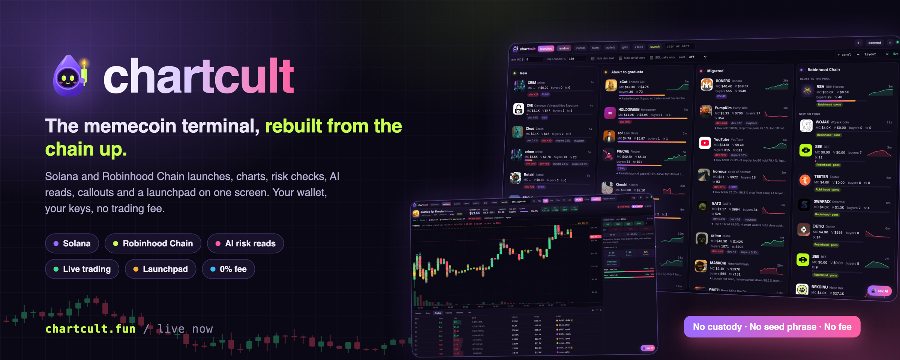](https://chartcult.fun)

### The memecoin terminal that shows you the chain, not its opinion of it.

Launches, charts, risk checks, callers, smart wallets, on-chain PnL and a launchpad on one screen. 
Solana and Robinhood Chain. No trading fee. No custody. No account needed.

**[Open the terminal](https://chartcult.fun)** · [Features](#features) · [How it reads the chain](#how-it-reads-the-chain) · [Architecture](#architecture) · [Security](SECURITY.md)

 

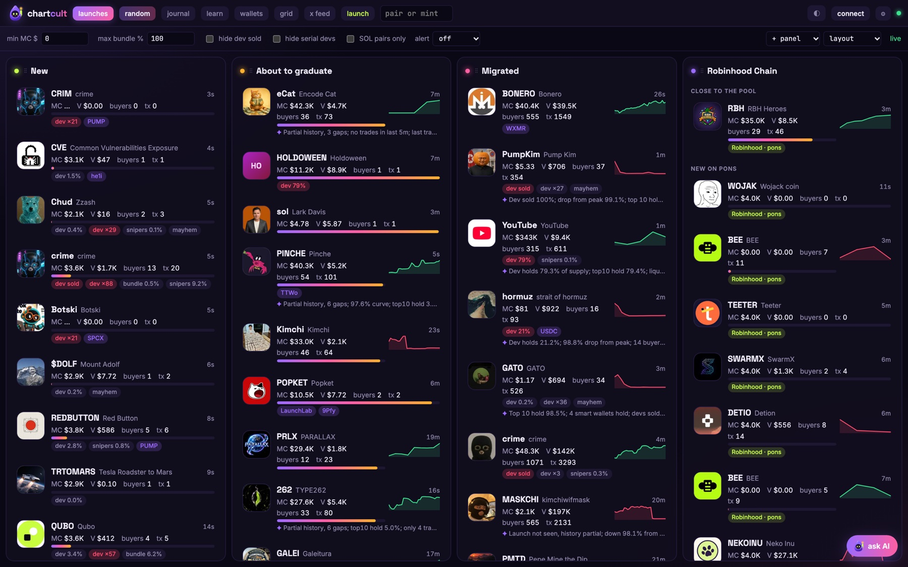

## Why Chartcult

Every memecoin terminal sells speed: a faster feed, a faster buy button, a faster bot. Speed matters, but speed on top of numbers you can't check is just a faster way to be wrong.

Open a coin on a typical terminal and you see a "dev holds" figure, a "bundle" figure, a "smart money" badge, a PnL number on someone's wallet. Which transactions are those from? Which wallets? You can't tell, and the same terminal takes a cut of every trade you make.

Blockchains are the most transparent markets ever built. Chartcult is built on one rule: **every number on the screen traces back to a transaction you can open yourself.**

<table>
<tr>
<th width="28%"></th>
<th width="36%">Typical terminal</th>
<th width="36%">Chartcult</th>
</tr>
<tr><td><b>Where the chart comes from</b></td><td>An aggregator's feed, starting when it noticed the coin</td><td>The coin's own swaps, decoded from the chain from the first trade</td></tr>
<tr><td><b>Risk labels</b></td><td>A score or a badge</td><td>A plain sentence with what was measured, and the slot or the sell behind it</td></tr>
<tr><td><b>Signals</b></td><td>The hits get posted</td><td>Every call stays on screen with what the coin did after, misses included</td></tr>
<tr><td><b>Wallet PnL</b></td><td>Only trades made through that platform</td><td>Every transaction the wallet signed, whatever bot or app sent it</td></tr>
<tr><td><b>Paper trading</b></td><td>Filled at the price you clicked</td><td>Filled at the next real trade, with fees and price impact from the pool's reserves</td></tr>
<tr><td><b>Fee on your trades</b></td><td>A cut on every buy and sell</td><td><b>0%</b> on top of the venue</td></tr>
<tr><td><b>Account</b></td><td>Sign-up, email, often a custodial wallet</td><td>None needed. Your lists, alerts and journal live in your browser</td></tr>
</table>

 

## Features

<table>
<tr>
<td align="center" width="25%"><a href="#the-launch-feed"><b>Launch feed</b></a></td>
<td align="center" width="25%"><a href="#charts-built-from-swaps"><b>Charts from swaps</b></a></td>
<td align="center" width="25%"><a href="#checks-story-holders-and-dev"><b>Checks, Story, Holders, Dev</b></a></td>
<td align="center" width="25%"><a href="#radar"><b>Radar</b></a></td>
</tr>
<tr>
<td align="center"><a href="#callers"><b>Callers</b></a></td>
<td align="center"><a href="#smart-wallets"><b>Smart wallets</b></a></td>
<td align="center"><a href="#on-chain-pnl"><b>On-chain PnL</b></a></td>
<td align="center"><a href="#copy-check"><b>Copy check</b></a></td>
</tr>
<tr>
<td align="center"><a href="#replay-and-paper-trading"><b>Replay and paper</b></a></td>
<td align="center"><a href="#hyperliquid-whales"><b>Hyperliquid whales</b></a></td>
<td align="center"><a href="#alerts-with-the-tab-closed"><b>Telegram alerts</b></a></td>
<td align="center"><a href="#and-the-rest"><b>Grid, launchpad, Learn, AI</b></a></td>
</tr>
</table>

### The launch feed

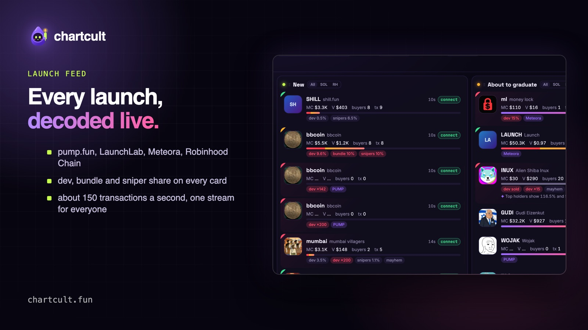

A live view of every new launch in three columns: **New**, **About to graduate** and **Migrated**, plus Robinhood Chain. It covers pump.fun, Raydium LaunchLab (bonk.fun and others), Meteora's Dynamic Bonding Curve (bags, believe and others) and pons on Robinhood Chain. One server holds one stream of the chain for everyone and decodes the events itself, so the feed costs the same with one visitor or ten thousand.

Every card carries the facts that decide whether a coin is worth a second look:

- **dev**: the share of supply the creator holds right now, and **dev sold** the moment they dump more than half;
- **bundle**: supply held by wallets that bought in the same slot as the create;
- **snipers**: supply held by wallets that bought in the first seconds;
- **dev ×N**: how many coins this creator launched while we watched, red when none of them reached a pool.

Filter by market cap, bundle share, dev sold, serial devs and quote asset, and get a chime plus a desktop notification for every coin that passes.

### Charts built from swaps

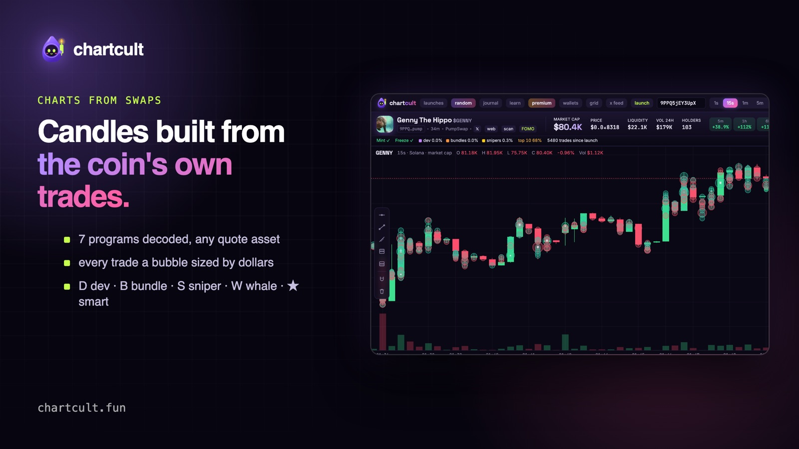

Candles come from the coin's own decoded swaps, not from an API. Our own canvas chart engine, written from scratch with zero dependencies: 1 second to 4 hour candles, market cap or price on the axis, drawing tools, a dozen indicators and memecoin price formatting (`0.0₅411` instead of `0.00000411`).

Every trade is a bubble sized by dollars, and the wallets that matter carry a letter: **D** dev, **B** bundle, **S** sniper, **W** whale, **K** a KOL from your own list, **★** a proven smart wallet.

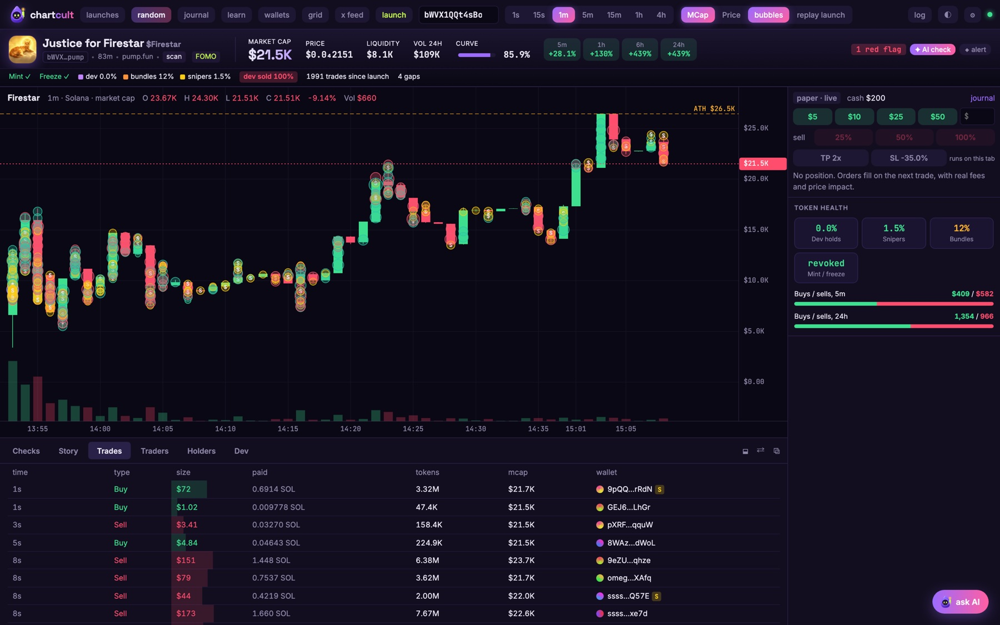

### Checks, Story, Holders and Dev

<table>
<tr>
<td width="50%">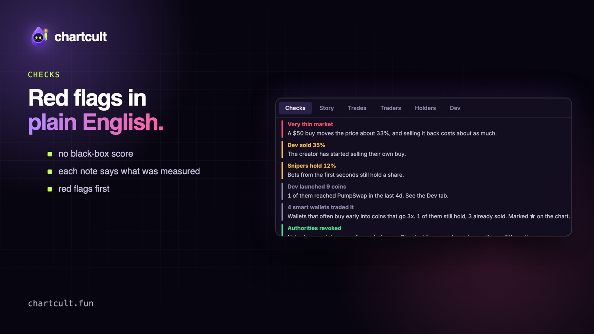</td>
<td width="50%">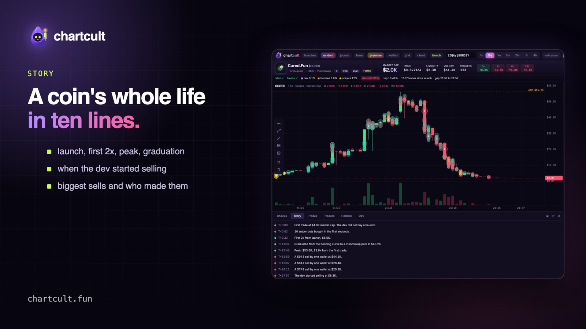</td>
</tr>
</table>

- **Checks**: plain-language risk notes, red flags first. Dev sold, **dev moved out** (the dev's real balance, read from the chain, against what the dev bought and sold: tokens sent to other wallets by plain transfer don't hide behind "dev hasn't sold"), bundle and sniper shares, mint and freeze authority, how far a $50 buy moves the price, serial launchers. Each note says what was measured and why it matters.
- **Story**: the coin's life as a timeline of sentences. What the dev and the bundles bought at launch, the first 2x, the peak, when the dev started selling, when the bundles sold half, the graduation.
- **Holders**: the top 20 holders as a bubble map, sized by share and colored by label, with lines between wallets the chain shows acting together: bought for in one transaction, first buys in the same quiet slot, or funded by the same wallet. The curve and the pool are named in the caption, not drawn. Top holders who never bought are named too: their tokens came by transfer.
- **Dev**: every coin this creator launched while the server was watching, with its peak and how much of their own buy they dumped. The dev dossier follows the money behind the dev: who funded them, and which launch buyers were funded by the same wallet.

Two more opinions sit one click away: a [CrawlHive](https://crawlhive.xyz) swarm scan on the Checks tab, and a [Tracehound](https://tracehound.pro) forensic deep check of the dev on the Dev tab.

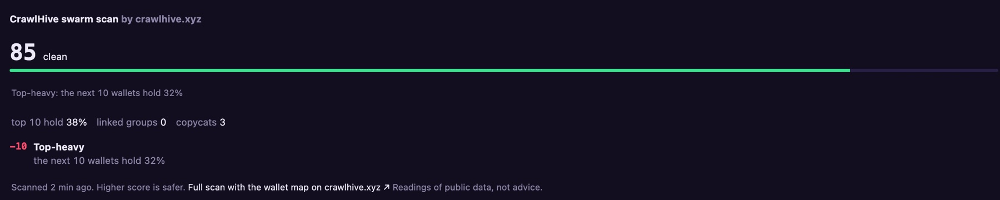

### Radar

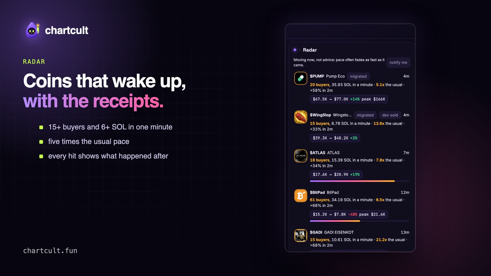

Some of the best moves happen after launch, when a coin that has been quiet for an hour suddenly gets a crowd. Radar watches every trade the server already decodes, so it costs zero extra calls to the chain. It fires when a coin at least ten minutes old gets, in one minute: 15 or more distinct buyers, 6 SOL or more of buying at 1.5x the selling, five times its usual pace, price up 20% in two minutes and a market cap past $15K.

And it keeps the receipts. From one window of 24 hits:

| After firing | Hits |
|---|---|
| went 25% or more higher | 14 of 24 |
| went 50% or more higher | 8 of 24 |
| doubled | 4 of 24, best 3.6x |
| **below where it fired, right now** | **17 of 24** |

That last row stays on the screen. Momentum fades as fast as it comes, and a radar that hides its misses is selling you something.

### Callers

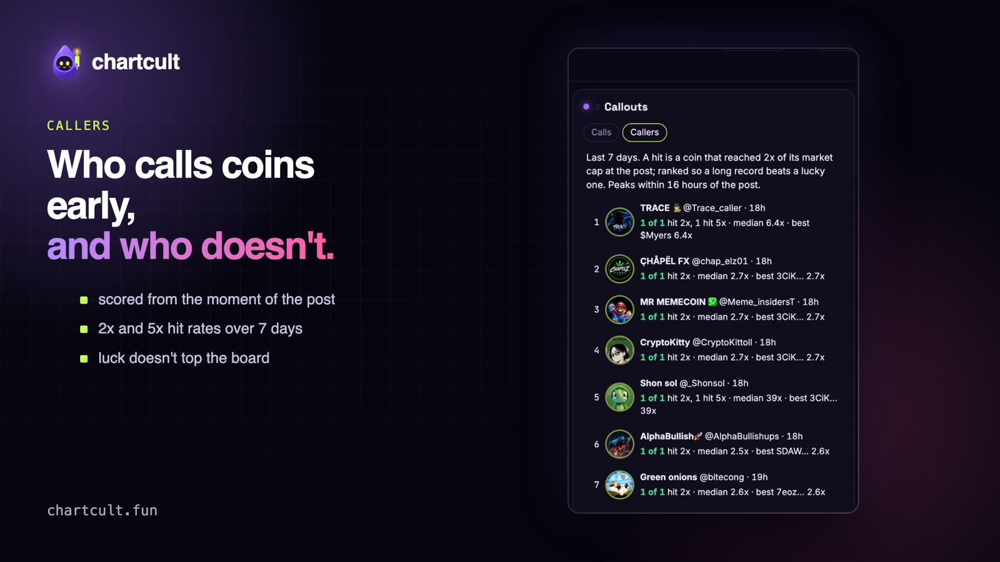

The Callouts panel catches X posts that name a coin by address, by a pump.fun, DexScreener or GMGN link, or by a $TICKER that matches exactly one live coin. Each call shows the market cap at the post, now, and the peak since, and sits on the coin's chart as the caller's avatar on the bar it was posted.

The **Callers** board ranks the accounts behind the last 7 days of calls: how many coins reached 2x and 5x from the post, the median peak, the best call. A coin called twice counts once. Big tickers like $BTC and $SOL are ignored, so nobody farms the board by "calling" Bitcoin. Ranking uses the lower bound of the hit rate: 6 hits out of 8 beats 1 out of 1. Luck doesn't top the board, consistency does.

### Smart wallets

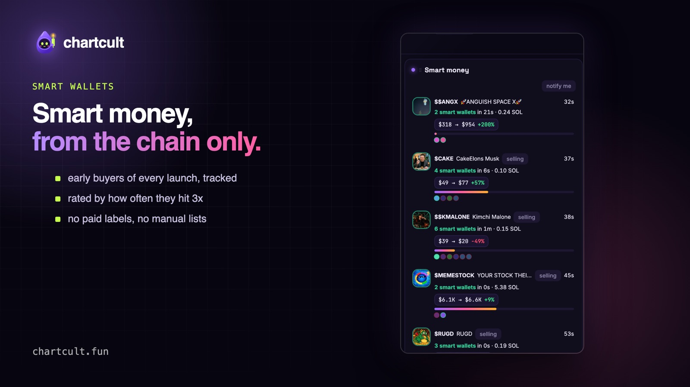

The server records the first 20 buyers of every launch it sees and, once the coin has played out, whether it did 3x from each buyer's entry. Wallets with a long record of early entries into runners rise, bots that buy everything fall out on their own. No paid labels, no manual lists. Follow any wallet and get a notification the moment it trades.

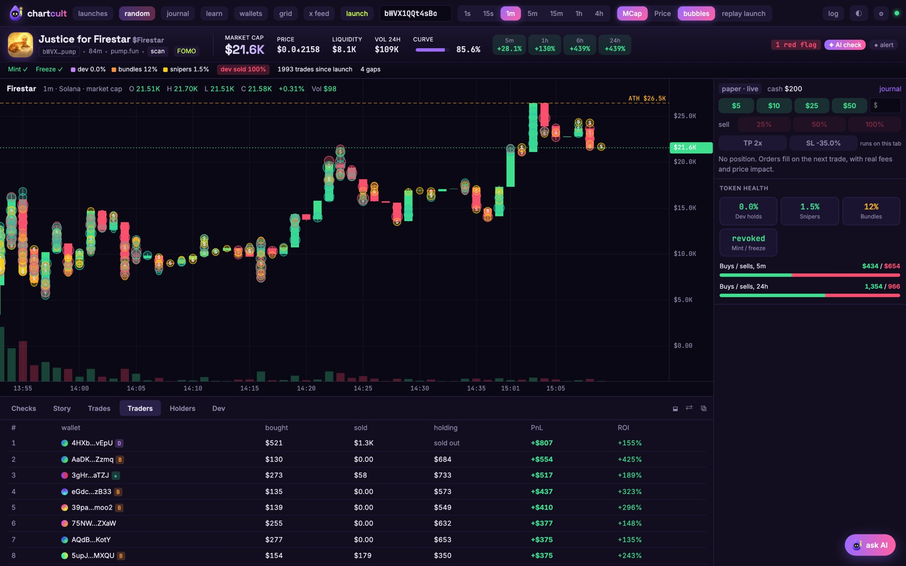

### On-chain PnL

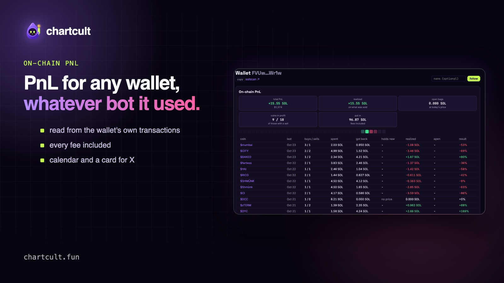

PnL on most platforms only counts trades made through that platform. Chartcult reads the wallet's own signed transactions straight from the chain, whatever app or bot sent them, so the cost includes everything the wallet really paid: venue fee, bot fee, priority fee, tips. Realized PnL on average cost, open bags at today's price, a calendar by day and a card to share. What can't be priced honestly is marked or left out, and the page says so.

### Copy check

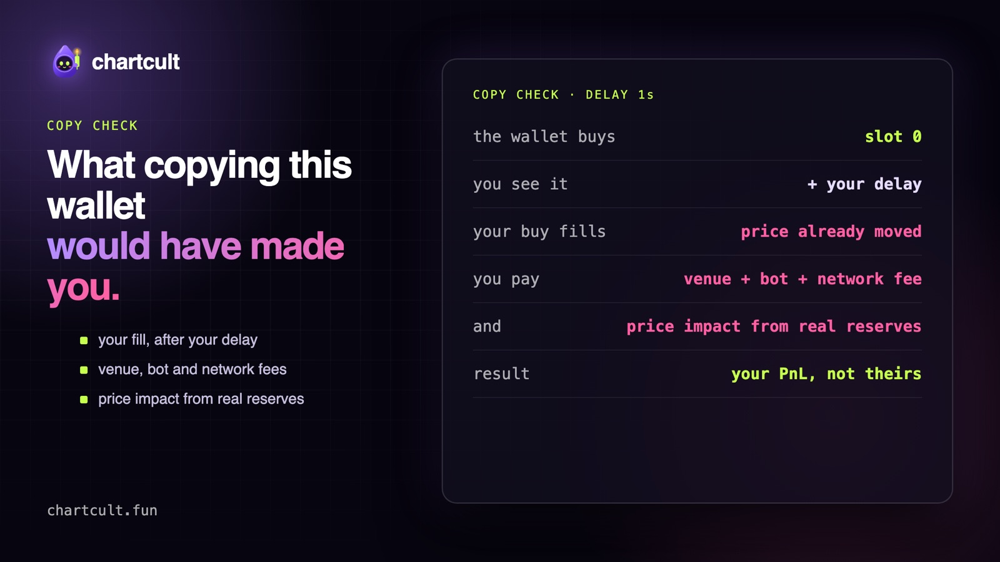

Every "copy this wallet" pitch shows you the wallet's PnL. Copy check shows you yours: each of its buys becomes your buy, each sell sells the same share, filled after your delay (next block, 1 second, 3 seconds) at the price the market had already moved to, with every fee and price impact. For most wallets the answer is uncomfortable, and that's the point.

### Replay and paper trading

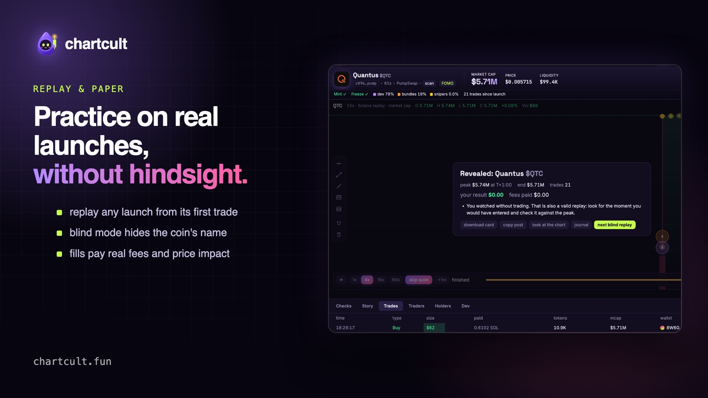

- **Replay any launch** from its first trade at 1x to 60x speed. The chart, the trades and the holder mix only know what had happened by the cursor.
- **Blind replay** hides the coin's name, so you can't cheat with hindsight.
- **Honest fills**: every paper order waits for the next real trade and pays the venue fee, your bot fee, priority fee and price impact from the pool's actual reserves.
- **Journal**: win rate, profit factor, fees as a share of losses, drawdown, best and worst hours.

When you're ready, live trading is on the same ticket: swaps from your own wallet through Jupiter on Solana, and straight on the pons curve on Robinhood Chain.

### Hyperliquid whales

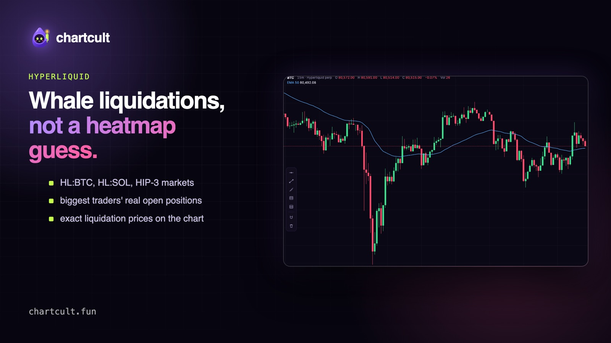

Type `HL:BTC`, `HL:SOL` or a HIP-3 market like `HL:xyz:NVDA`. Every Hyperliquid print names buyer and seller, so Chartcult collects the largest traders on the market, reads their actual open positions and draws their exact liquidation prices on the chart. Not a heatmap model: the positions themselves.

### Alerts with the tab closed

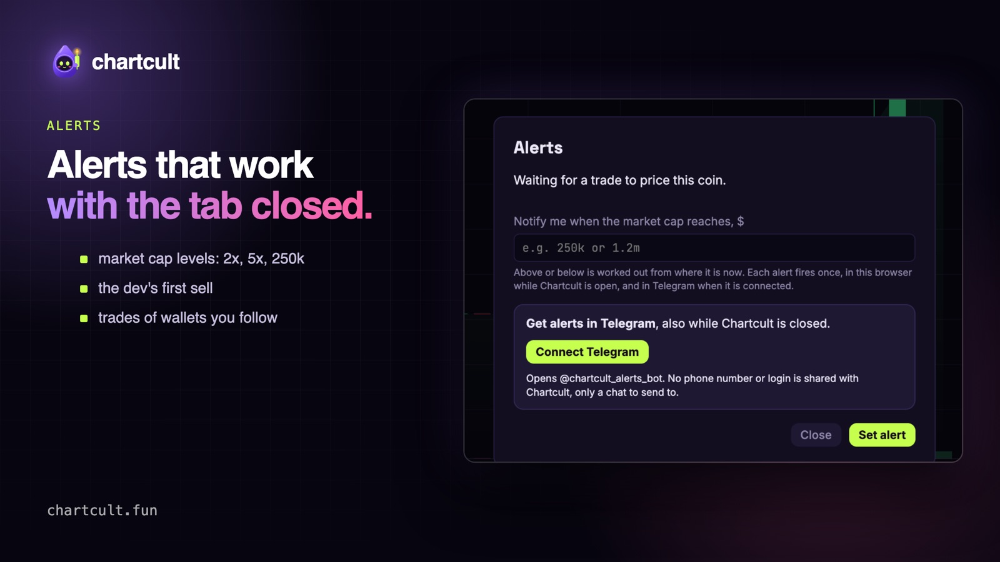

Market cap alerts (2x, 5x, 10x, -50% or any level like `250k`), the dev's first sell and followed-wallet trades. Connect [@chartcult_alerts_bot](https://t.me/chartcult_alerts_bot) once and the server checks your alerts against every trade it decodes. No phone number and no Telegram login ever reach us, only a chat id. `/list` shows your alerts, `/stop` disconnects.

### And the rest

<table>
<tr>
<td width="50%">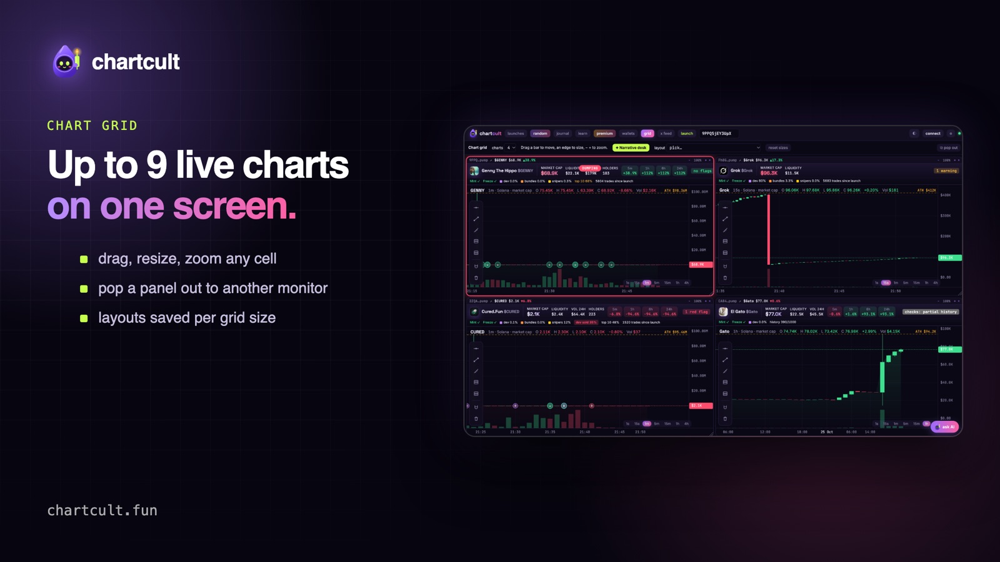 <b>Chart grid.</b> Up to 9 live charts on one screen. Drag, resize, hide and add panels, pop any panel out to another monitor.</td>
<td width="50%">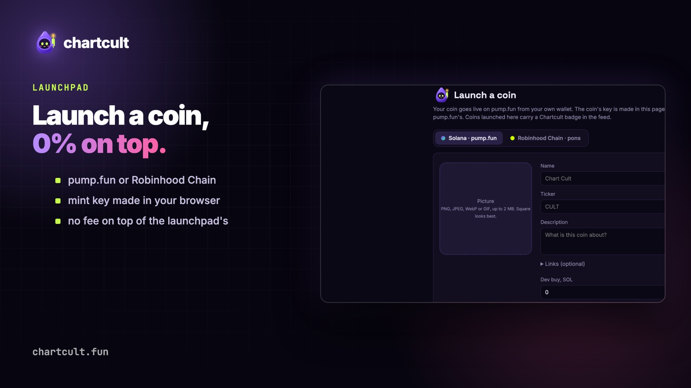 <b>Launchpad.</b> Launch on pump.fun or on Robinhood Chain from your own wallet. The mint key is made in your browser and never leaves it. No fee on top.</td>
</tr>
<tr>
<td width="50%">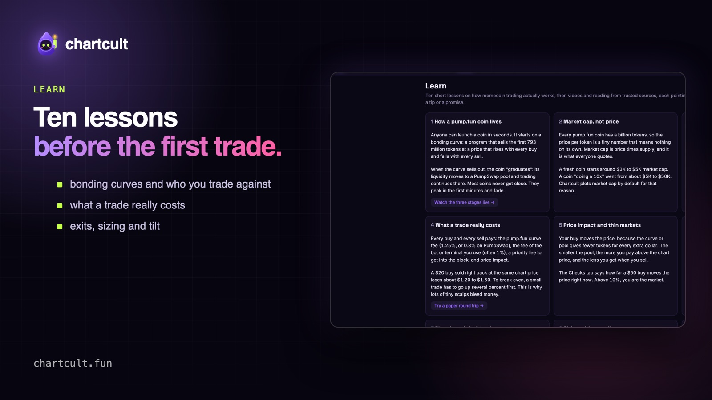 <b>Learn.</b> Ten short lessons on bonding curves, who you trade against, what a trade really costs, exits and sizing, each linked to the part of the app that shows it.</td>
<td width="50%">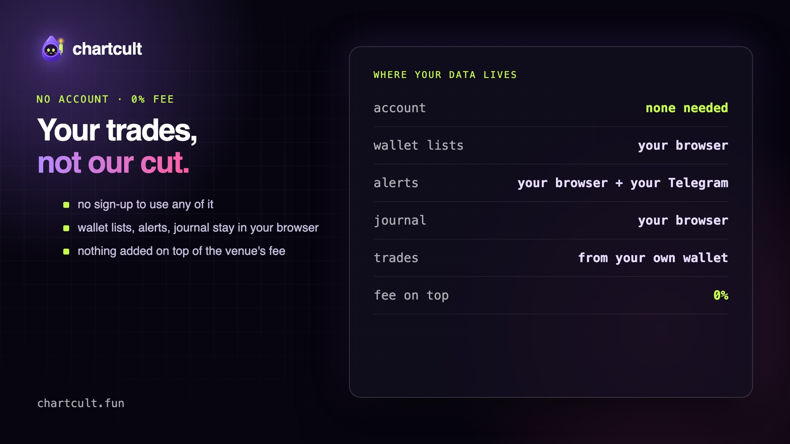 <b>No account, 0% fee.</b> No sign-up to use any of it. Wallet lists, alerts and journal stay in your browser.</td>
</tr>
</table>

**AI helper.** Ask about any coin or wallet and it answers from the same numbers the terminal shows, in your language. It flags partial data and explains risk. It never tells anyone to buy or sell, and never promises a return.

**A desk for narratives.** One click builds a six-panel desk: new coins, coins about to graduate, three X feeds and the launchpad. See the story on X, find the coin, without leaving the screen.

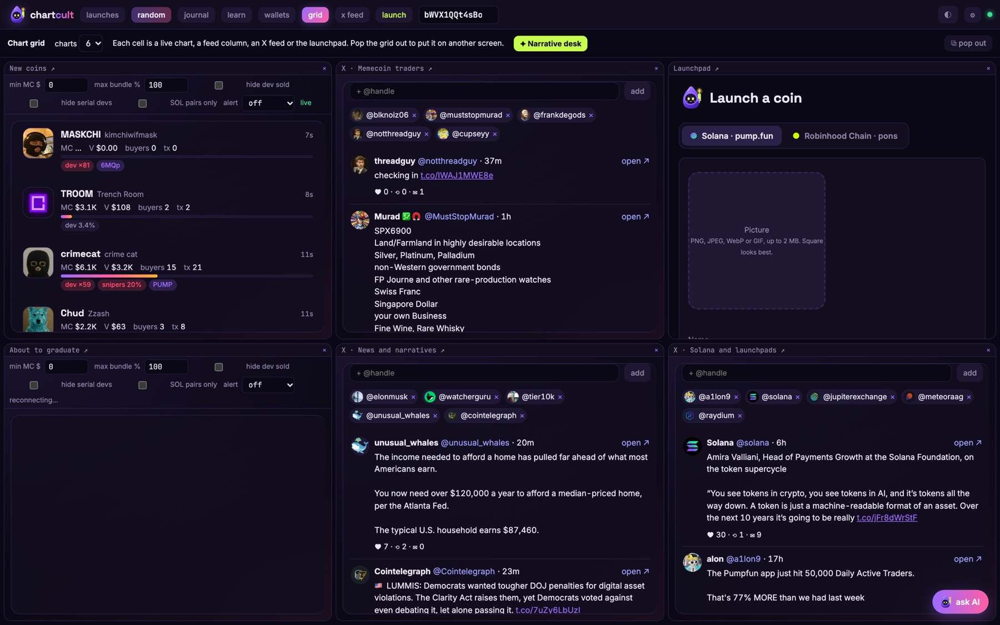

## How it reads the chain

We did not copy anyone's code or design. What we took apart is the chain itself: the binary formats the launchpads write, read from each program's published IDL or source and checked against captured mainnet transactions.

| Venue | What we decode | How |
|---|---|---|
| **pump.fun** bonding curve | create, buy, sell, complete, migrate | Anchor events in transaction logs, checked against the program that emitted them |
| **PumpSwap** | pool trades, pool creation | logs, and self-CPI events when logs are cut |
| **Raydium LaunchLab** | launches, curve trades, migrations | full transactions, instructions by IDL |
| **Raydium CPMM** and **AMM v4** | pool trades | events and `ray_log` lines |
| **Meteora DBC** | launches, curve trades, migrations | self-CPI event data, configs read on chain |
| **Meteora DAMM v2** | pool trades | self-CPI event data |
| **pons** on Robinhood Chain | launches, curve buys and sells, graduation | factory and curve events from the verified contract sources |

Seven Solana programs, both pool orientations, any quote asset. The decoders are covered by **321 tests** that replay real on-chain events, so a change that breaks how a swap is read gets caught before it reaches a chart.

<b>Why this matters: the day graduations disappeared from the logs</b>

 

pump.fun moved graduations to a new `MigrateV2` instruction. Its migration event no longer shows in the logs, and the transaction is so large that Solana cuts the logs short. A terminal that only reads logs stops seeing graduations. We traced it to the instruction level: Chartcult now detects migrations from the PumpSwap pool the migration creates, and fetches the cut transactions whole.

The same care goes into prices. A trade's price is what it paid divided by what it got, so a sell of one lamport for one raw token unit once priced coins thousands of times too high. Trades too small to carry a price are dropped before they reach a candle.

## Architecture

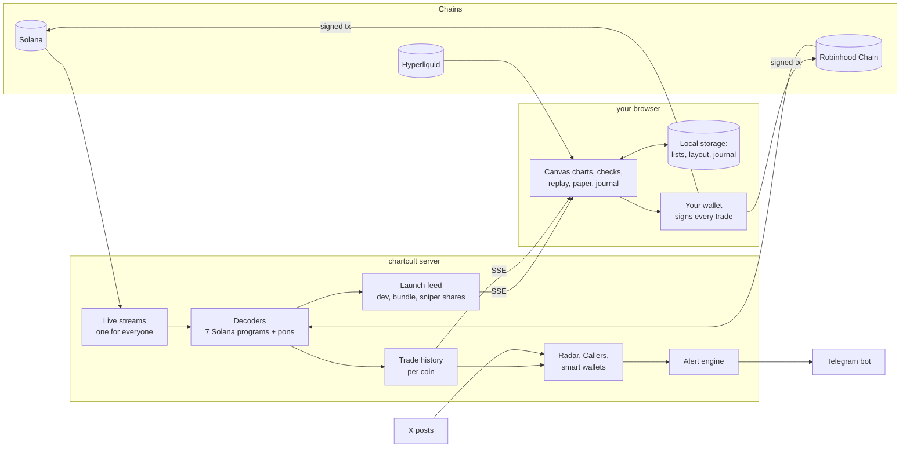

- **One stream, many viewers.** The server decodes the chain once and sends the feed and every coin's live trades to browsers over server-sent events. The cost does not grow with visitors.
- **Keys stay where they belong.** RPC, X and AI keys live on the server and never reach the page. Your keys never leave your wallet.
- **Your data stays in your browser.** Lists, layouts, alerts, paper accounts and the journal live in local storage.
- **TypeScript end to end**: our own canvas chart engine, a decoder per venue, a Node server that watches the chains live, viem for Robinhood Chain.

## Premium, paid by burning the token

The terminal is free, and **everything that keeps you safe stays free**: dev, bundle and sniper shares, mint and freeze checks, charts, trading, the launchpad and the lessons. Premium tiers add the edge on top for 30 days at a time, paid in the Chartcult token. **Every token paid is burned**: it leaves the supply for good and nobody receives it.

| | Free | Cultist $10 | Insider $100 | Whale $500 |
|---|:---:|:---:|:---:|:---:|
| Safety checks, charts, trading, launchpad | ✓ | ✓ | ✓ | ✓ |
| AI questions a day | 5 | 25 | 100 | no cap |
| Settings saved to your wallet, every device | | ✓ | ✓ | ✓ |
| One click buys from the feed | | ✓ | ✓ | ✓ |
| CrawlHive swarm scan on the Checks tab | | ✓ | ✓ | ✓ |
| Smart money signals: proven wallets entering the same coin, live | | | ✓ | ✓ |
| Early callouts from all of X | | | ✓ | ✓ |
| Dev dossier: who funded the dev, buyers funded by the same money | | | | ✓ |
| Every other tool we plug into Chartcult | | | | ✓ |

Prices are set in dollars. When you press Pay, the server prices your tier in tokens and holds the quote for 10 minutes. Your wallet signs one transaction that burns exactly that amount with a memo naming the quote; the server checks it on chain and turns the tier on. Until the token launches, every tier is open to everyone.

## Security: why you can connect your wallet

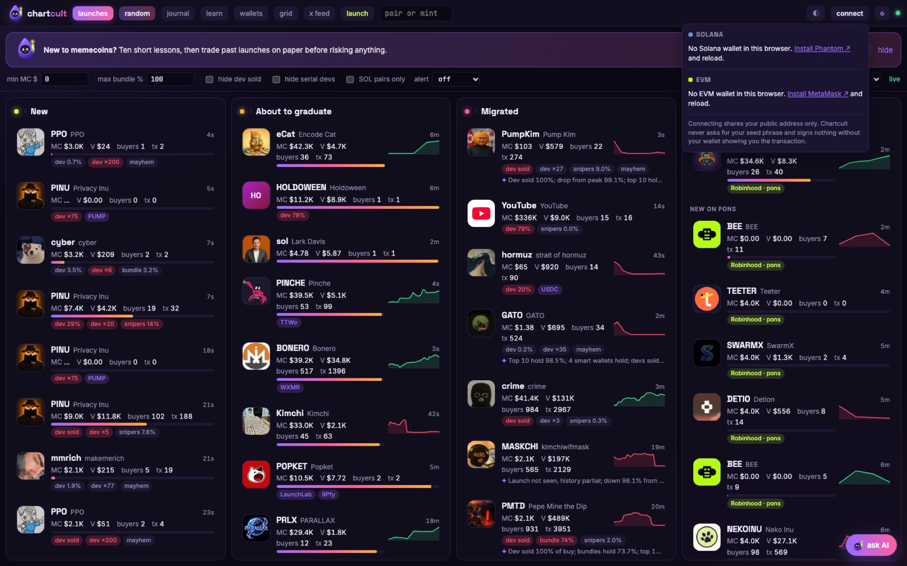

- **Non-custodial.** Chartcult never asks for a seed phrase or a private key, holds no funds and cannot move yours.
- **Nothing is signed without you.** Your wallet signs only when you trade for real, launch a coin or pay for a tier, and only after the page shows you what you pay and what you get.
- **Checked before you sign.** A Solana swap is refused unless your own wallet is its fee payer; a Robinhood Chain sell approves exactly the amount sold, never an unlimited allowance.
- **No fee.** Chartcult adds nothing on top of the venue on any trade or launch.

Read the full [security model](SECURITY.md): what connecting asks for, what every signature does, what the server can and cannot see, and how to report a vulnerability.

> Memecoins are high risk and most of them go to zero. Red flags in Chartcult are readings of public data, not guarantees, and nothing on the site is financial advice.

## Links

**[chartcult.fun](https://chartcult.fun)** · **[Telegram alerts bot](https://t.me/chartcult_alerts_bot)** · **[Security](SECURITY.md)**

Built from scratch. No code, assets or docs from any other platform.

