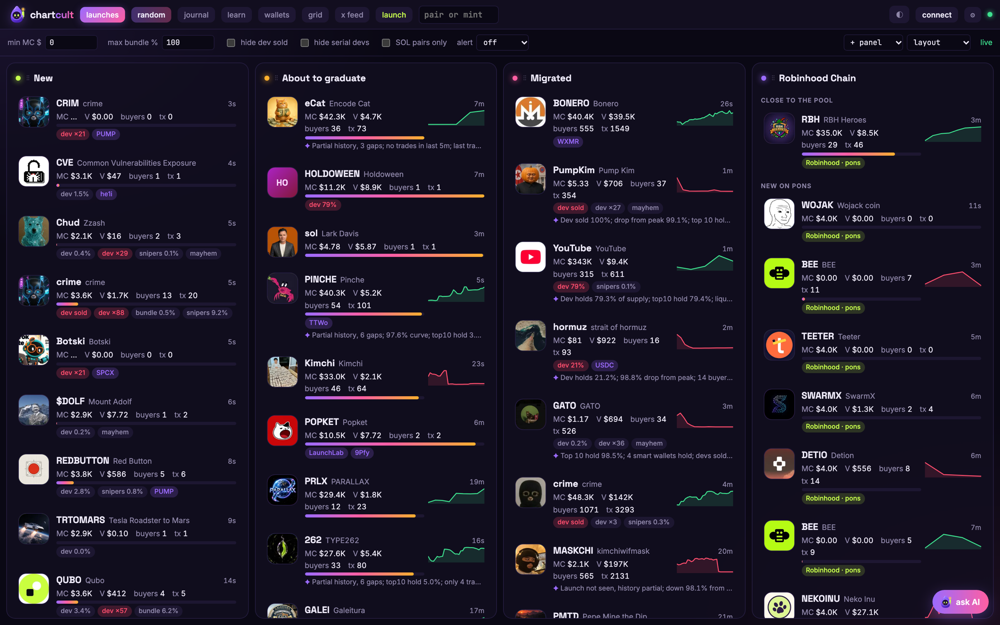
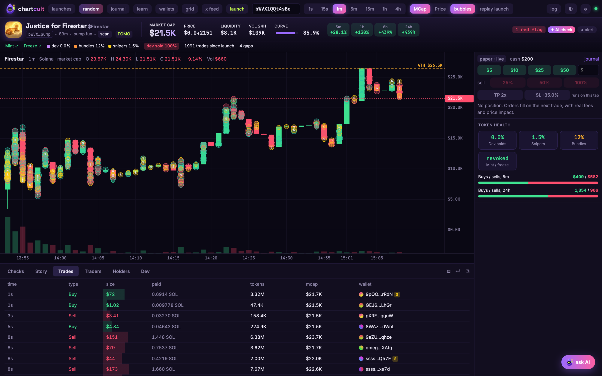
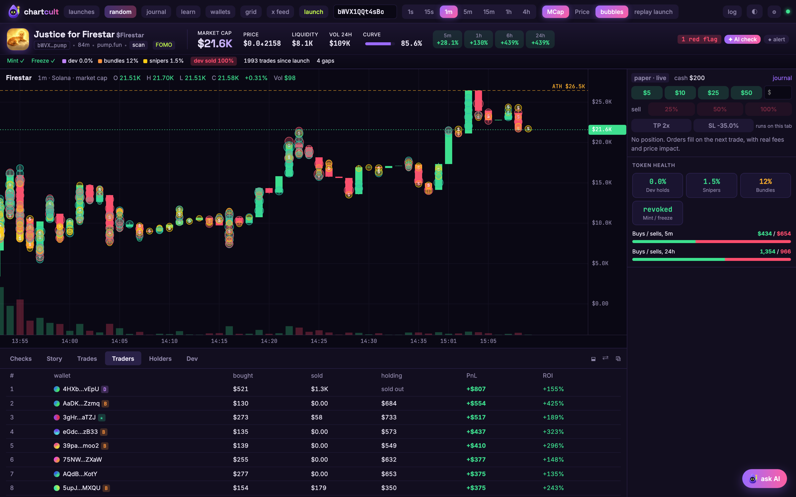
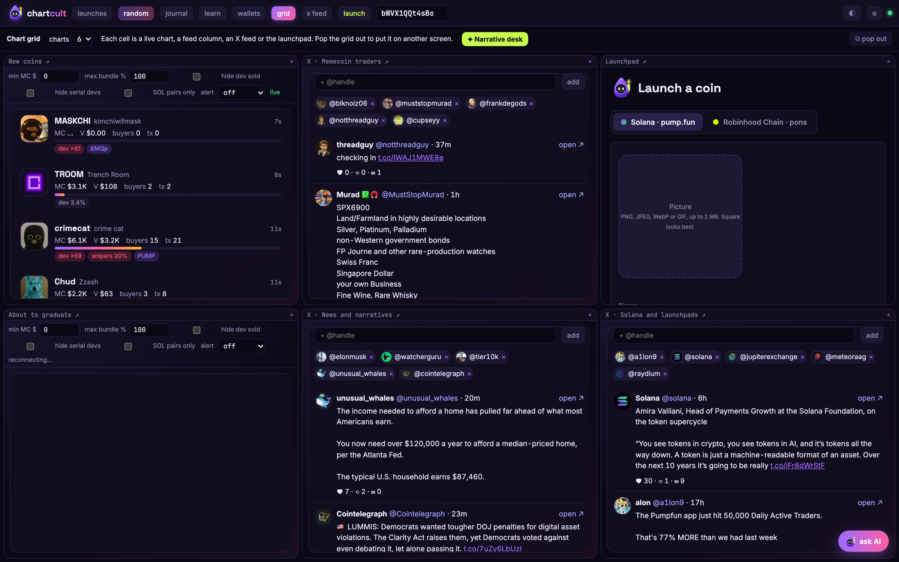
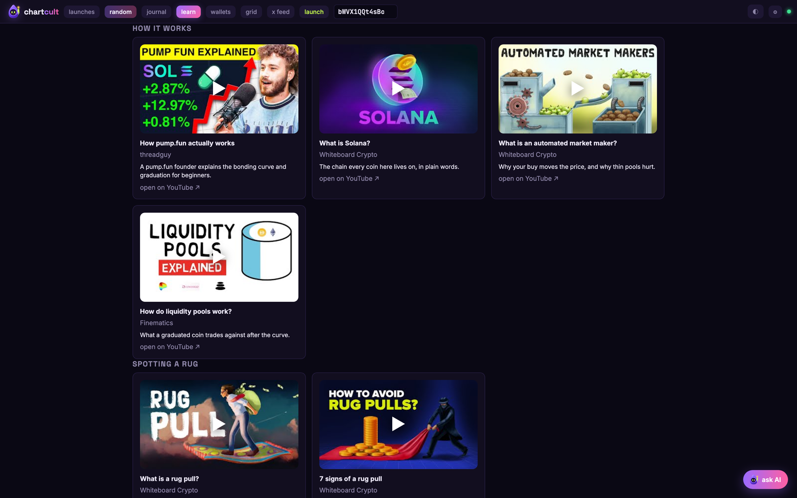
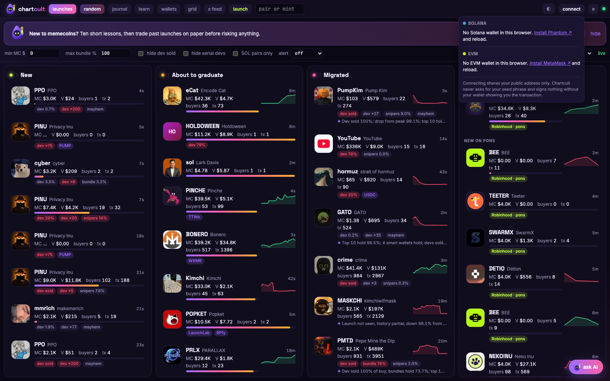

# chartcult

**A memecoin terminal rebuilt from the chain up.**
Solana and Robinhood Chain launches, charts, risk checks, AI reads and a launchpad, in one screen. No trading fee, no custody, no account.

**[chartcult.fun](https://chartcult.fun)**

---

## Why we built it

Traders already juggle GMGN, Axiom, Photon, pump.fun, DexScreener, TradingView and a dozen X tabs. We used them every day and kept hitting the same walls:

- the chart only starts when the aggregator noticed the coin, so the launch minutes are missing;
- "dev holds 0%" while the dev's other wallets bought the whole curve in the launch block;
- every buy and sell pays the terminal's cut on top of the venue fee;
- you cannot practice without risking money;
- narratives move on X, coins move on the terminal, and the two never meet on one screen;
- nothing outside Solana and EVM majors, so new chains like Robinhood Chain are invisible.

Chartcult is our answer: we studied how these platforms present a coin and how traders actually use them, then rebuilt the whole pipeline ourselves, from the raw chain data to the screen, and fixed what bothered us.

## Reverse engineering the chain, not the competition

We did not copy anyone's code or design. Every chart, every decoder and every panel is written from scratch. What we reverse engineered is the chain itself: the binary formats the launchpads write, so the terminal reads trades straight from Solana and Robinhood Chain instead of trusting an aggregator.

| Source | What we decode | How |
|---|---|---|
| pump.fun bonding curve | create, buy, sell, complete, migrate | Anchor events in transaction logs, checked against the program that emitted them |
| PumpSwap | pool trades, pool creation | logs and self-CPI events when logs are cut |
| Raydium LaunchLab, CPMM, AMM v4 | trades, pools | full transactions and `ray_log` lines |
| Meteora DBC and DAMM v2 | trades, pools | self-CPI event data |
| Robinhood Chain (pons) | launches, curve buys and sells, graduation | factory and curve events, read with the verified contract sources |

A recent example of why this matters: pump.fun moved graduations to a new `MigrateV2` instruction. Its migration event no longer shows in the logs, and the transaction is so large that Solana cuts the logs short. A terminal that only reads logs stops seeing graduations. We traced it to the instruction level, now detect migrations from the PumpSwap pool the migration creates, and fetch the cut transactions whole.

## What we improved

### The launch screen

Four live columns: **New**, **About to graduate**, **Migrated** and **Robinhood Chain**. Every card carries the dev, bundle and sniper share of supply, how many coins this creator launched today and how many reached a pool, a price sparkline and a one-line AI read of the risk picture ("Dev sold 100% of buy; bundles hold 73.7%; top 10 hold 84.3%"). Columns can be reordered, resized, hidden or popped out to another screen.

### The coin page

- **The whole life of the coin on the chart.** Candles come from our own decoded trades. Minutes the server missed are filled from GeckoTerminal's minute bars, so there are no holes and no 50K-to-400K single candles.
- **Bar size follows the coin's age**: 1 second bars for a two-minute-old coin, 1 minute for a few hours old.
- **Token health card**: top 10 share, dev holding, snipers, bundles, holders, mint and freeze authority, buy and sell pressure over 5 minutes and 24 hours, holder distribution.
- **Every trade on the chart** as a bubble, tagged dev, bundle, sniper, whale, KOL or smart wallet; an all time high line.
- **Live**: the market cap flashes on every move, new trades flash in as they arrive.

### Traders, not just trades

The Traders tab ranks every wallet by profit on the coin: what it bought, sold and still holds, PnL and ROI. Smart wallets are the ones that keep showing up among the first buyers of launches that later went 3x, built from every launch the server watched, not bought from a label vendor.

### A desk for narratives

One click builds a six-panel desk: new coins, coins about to graduate, three X feeds with different lists (memecoin traders, news and narratives, Solana and launchpads) and the launchpad. See the story on X, find the coin, launch your own, without leaving the screen. Any cell can hold a chart instead.

### AI that reads the data, not the hype

An assistant on every page answers from the terminal's own data: coin reports, dev history, wallet records, the launch feed. It flags partial data, and it never tells anyone to buy or sell or promises a return. The same rules apply to the one-line reads on feed cards.

### Learn without losing money

Replay any finished launch from its first trade and trade it on paper with real fees and price impact, or take a **blind replay** with the name hidden until the end. A journal keeps every paper trade with the coin's state at entry. The Learn page has ten short lessons and videos from explainers with a track record.

### Trade on two chains

Connect a Solana wallet and an EVM wallet at the same time and trade both: Solana coins through Jupiter (pump.fun curves and pools), Robinhood Chain coins straight on their pons curve. New, About to graduate and Migrated mix both chains, with a switch per column.

### A launchpad on two chains

Launch a coin on **pump.fun** (Solana) or on **pons** (Robinhood Chain) from your own wallet. Chartcult adds no fee on top of the launchpad's.

## Security: why you can connect your wallet

Connecting a wallet to a trading site is a real risk, so here is exactly what Chartcult can and cannot do.

**What connecting asks for**
- **Solana**: the Wallet Standard `connect` call. Your wallet shares your public address. Nothing else.
- **EVM** (MetaMask, Rabby, Coinbase Wallet and other EIP-6963 wallets): `eth_requestAccounts`, which shares your public address. Reconnecting on a later visit uses `eth_accounts` only, so it never pops up a request by itself.
- No message signing, no delegation, no session keys. The only token approval Chartcult ever asks for is the exact amount of a Robinhood Chain sell, at the moment you confirm it.

**What we never have**
- **Your seed phrase or private key.** Chartcult never asks for them. If anything that claims to be Chartcult asks for a seed phrase, it is a scam.
- **Custody.** We hold no funds and cannot move yours. Nothing moves without your wallet's own confirmation. Paper trading, replays, charts, alerts and the AI need no wallet at all.

**When your wallet does sign**
Only when you trade for real or launch a coin, and only after your wallet shows you the full transaction. Paper trading is the default; real trading is a separate switch on the ticket.
- **Solana trades**: swaps are built by Jupiter for the exact amount you confirmed. Before your wallet is asked, the page shows what you pay, about what you get and the minimum after slippage, and checks that the transaction is paid by your own wallet. Your wallet signs it, the page sends it, and you get the Solscan link.
- **Robinhood Chain trades**: buys and sells go straight to the coin's pons bonding curve, with your address as the recipient and a minimum out. A sell first asks your wallet to approve exactly the amount being sold for that curve, never an unlimited allowance. Every trade is simulated on chain before it is shown to you.
- **Chartcult takes no fee** on any trade or launch.
- **pump.fun**: the coin's mint key is generated in your browser and never leaves it. Our server builds the create transaction, your wallet signs it, the page adds the mint's signature, and the server sends it to the network. The transaction creates your coin and, if you chose one, makes your dev buy. Nothing else.
- **Robinhood Chain**: your wallet sends one transaction to the pons factory (or pons' router for launch plus dev buy), with the launch fee and dev buy amount shown before you approve.

**What stays private**
- The wallets you follow, your KOL list, your layout, your paper journal and alerts live in your browser.
- Our RPC, X and AI keys stay on the server and are never sent to the page. The RPC proxy only answers our own site.
- The AI only sees public on-chain data and what you type into it.

**What we cannot promise**
Memecoins are high risk and most of them go to zero. Red flags in Chartcult are readings of public data, not guarantees, and nothing on the site is financial advice.

## Built with

TypeScript end to end: our own canvas chart engine, decoders for each launchpad, a Node server that watches the chains live and keeps trade history, Claude Haiku for the AI reads, viem for Robinhood Chain.

---

**[chartcult.fun](https://chartcult.fun)**

